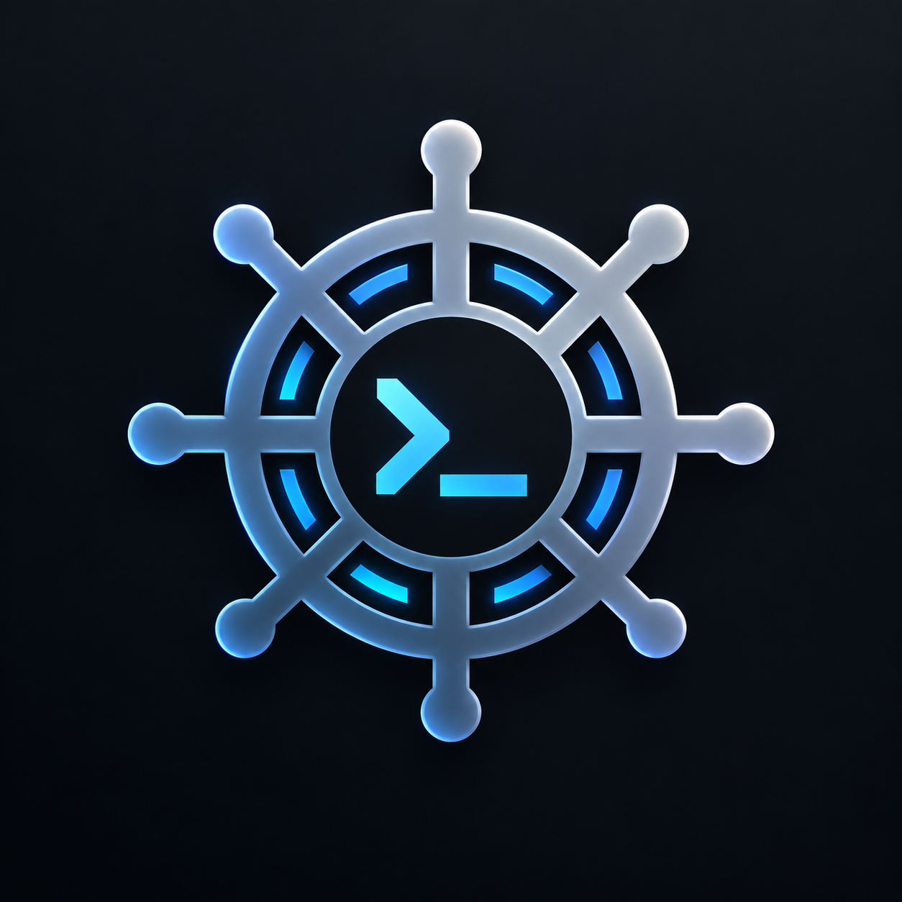

<div align="center">
  
  <h1>HELM</h1>
  <p><b>Human-Controlled AI Engineering Framework for Cursor & CLI</b></p>

  <a href="https://python.org"></a>
  <a href="https://cursor.com"></a>
  <a href="LICENSE"></a>
</div>

---

> **Agents investigate, propose, implement, and verify — humans decide, approve, and own the resulting Git history.**

HELM is an installable, repo-agnostic governance layer for **Cursor** (CLI and IDE). It equips AI agents to perform deep investigation, code edits, and verification checks while maintaining strict human-in-the-loop gates over architecture, business decisions, and Git releases.

---

## ⚡ Why HELM Exists

Autonomous AI coding agents can easily drift off-plan, fabricate unrequested dependencies, modify protected configuration files, or commit unverified changes directly to Git.

HELM solves this by establishing a **hard boundary between agent proposal and human decision**:
- **Zero Agent Commits**: Agents never commit, branch, rebase, or push code. The developer owns Git.
- **Cryptographic Gate Binding**: Phase state is derived from HMAC-signed human decisions and artifact SHA-256 hashes. If the working tree or artifacts change downstream, previous approvals automatically invalidate.
- **Fail-Closed Security Hooks**: Pre-execution guard hooks intercept shell, tool, file read, and MCP calls to enforce zero-trust access control.
- **Zero Third-Party Dependencies**: Pure Python 3.9+ standard library implementation — lightweight, fast, and dependency-free.

---

## 🔄 Workflow Pipeline

```
  YOU (Terminal)                           CURSOR (AI Agents)                    WORKFLOW STATE
  ──────────────                           ──────────────────                    ──────────────
  helm start PROJ-101 --tier 2
                                          /work PROJ-101     discovery  ─▶ WORK.md    AWAITING_DISCOVERY_APPROVAL
  review WORK.md
  helm approve discovery
                                          /continue          planner    ─▶ PLAN.md    AWAITING_PLAN_APPROVAL
  helm approve plan
                                          /continue          test-analyst ─▶ TEST-PLAN.md
                                                             implementer ─▶ IMPL.md + code
                                                             helm verify (signed check suite)
                                          /review            reviewer   ─▶ REVIEW.md  AWAITING_FINAL_APPROVAL
  review diff + REVIEW.md
  helm approve final
  git commit / push / PR   ← YOURS        helm finish --clean                        READY_FOR_DEVELOPER → IDLE
```

---

## 🚀 Quick Start

### 1. Global Setup (One-Time)

Install HELM globally so the `helm` command is available everywhere:

```bash
python3 install.py --global
```

### 2. In ANY Repository

Simply navigate to any project repository and run:

```bash
helm start
```

> **Automatic Repository Initialization**: If HELM is not yet initialized in the target repository, `helm start` will automatically prompt to set up `.cursor/`, `.helm/`, and governance rules for that project on the fly.

### 3. First-Time Verification Checklist

1. **Protect Framework Configuration**: Add `/.cursor/ /.helm/ /AGENTS.md` to `CODEOWNERS`.
2. **Configure Jira / Atlassian MCP** (Optional): Set credentials in `.cursor/mcp.json` or leave as placeholders for Local Story Mode (`STORY.md`).
3. **Verify Security Hooks**:
   ```bash
   helm doctor --live
   ```
   *Proves that fail-closed guard hooks actively fire in your local Cursor CLI environment.*

---

## 📊 Workflow Tiers

Choose the appropriate governance tier when starting a task (`helm start <ID> --tier 1|2`):

| Tier | Best For | Gates Required | Workflow Pipeline |
| :--- | :--- | :--- | :--- |
| **Tier 1 (Fast-Track)** | Small, well-understood tasks | Discovery & Final | `WORK.md` (Brief + Plan merged) $\rightarrow$ Implementation $\rightarrow$ Verification $\rightarrow$ Final Approval |
| **Tier 2 (Standard)** | Feature engineering & complex refactors | Discovery, Plan, & Final | Discovery $\rightarrow$ Plan $\rightarrow$ Test Plan $\rightarrow$ Implementation $\rightarrow$ Verification $\rightarrow$ Independent Review $\rightarrow$ Final Approval |

---

## 🛠 Command Reference

### Human Commands (Interactive Terminal Required — Denied to AI Agents)

| Command | Purpose |
| :--- | :--- |
| `helm start <ID> [--tier 1\|2]` | Begin a new task (snapshots Git baseline and opens interactive wizard) |
| `helm approve [gate]` | Cryptographically sign and approve a pending gate (`discovery`, `plan`, `final`) |
| `helm reject [gate] -m "..."` | Reject a gate and provide mandatory feedback to the agent |
| `helm unblock -m "..."` | Provide a human resolution for an agent frozen in `BLOCKED` state |
| `helm finish [--clean]` | Complete task, archive artifacts, and promote human decisions to `docs/decisions.md` |
| `helm abort` | Cancel the active task and discard transient workflow state |
| `helm reset [--clean]` | Reset all task state and clear `.helm/work/` workspace |
| `helm setup` | Configure specialized LLM models and reasoning effort for Planner/Reviewer roles |

### Inspection & Diagnostic Commands (Agent-Safe)

| Command | Purpose |
| :--- | :--- |
| `helm status [--json\|--brief]` | Inspect current workflow phase, writable path scopes, and gate status |
| `helm check [artifact]` | Validate schema constraints, line caps, and placeholder hygiene |
| `helm verify [--only check]` | Run the repository verification check suite (`.helm/repo/verify.json`) |
| `helm doctor [--live]` | Audit environment health, hook bindings, and policy integrity |
| `helm log` | Display the HMAC-signed audit log of human decisions |
| `helm metrics` | Report token budget, file reads outside scope, and tool calls |

### Continuous Integration

```bash
python3 .helm/bin/helm ci --base origin/main --require-overlay
```
Key-free, state-free CI check runner for GitHub Actions and Bitbucket Pipelines. Validates hook configuration, protected path changes, skill lock integrity, and prevents committed task artifacts.

---

## 🔒 Security & Threat Model

HELM implements **defense-in-depth** across three security classes:

| Class | Mechanism | Protected Scope |
| :--- | :--- | :--- |
| **Enforced** | Fail-Closed Hook Block (`helm_guard.py`) | No Git writes (`commit`, `push`, `rebase`), no secret file access (`.env`, `.pem`, `id_rsa`), no file deletion (`rm`, `unlink`), read-only Atlassian MCP tools. |
| **Detected** | Cryptographic Snapshot & Manifests | HEAD, branch, reflog, and stash baseline drift detection. Protected path tamper detection via HMAC-signed `integrity.json`. |
| **Instructed** | Prompt Constraints & Review Gates | Traceability table mapping every acceptance criterion to an existing test file (`pass`, `fail`, `unproven`). |

For complete threat analysis and residual risk evaluations, see [`docs/THREAT-MODEL.md`](docs/THREAT-MODEL.md).

---

## 📚 Documentation

- [CLI Architecture & Reference](docs/CLI.md)
- [HELM Methodology Spec v2](docs/METHODOLOGY.md)
- [Mermaid Micro-Diagram Standards](docs/DIAGRAMS.md)
- [Threat Model & Risk Analysis](docs/THREAT-MODEL.md)
- [Skill Supply Chain Policy](docs/SKILLS-POLICY.md)
- [Operations & Troubleshooting Runbook](docs/OPERATIONS.md)
- [CI Pipeline Recipes](docs/ci/github-actions.yml)

---

## 📄 License

Distributed under the MIT License. See [`LICENSE`](LICENSE) for details.
