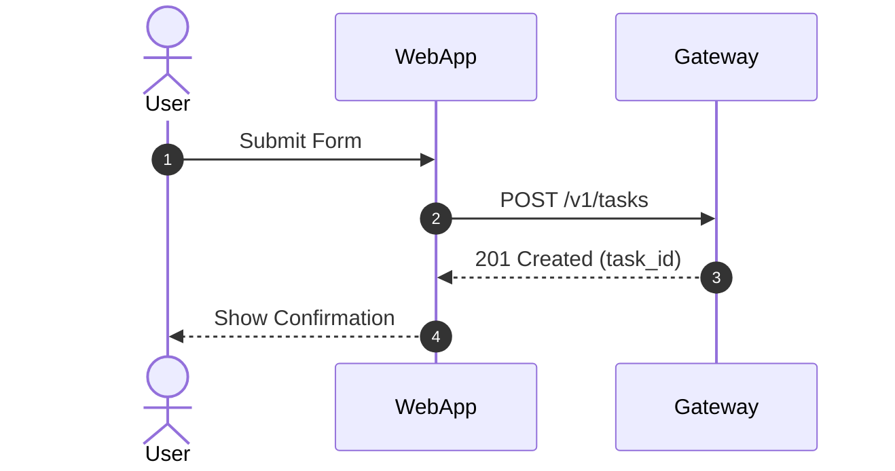
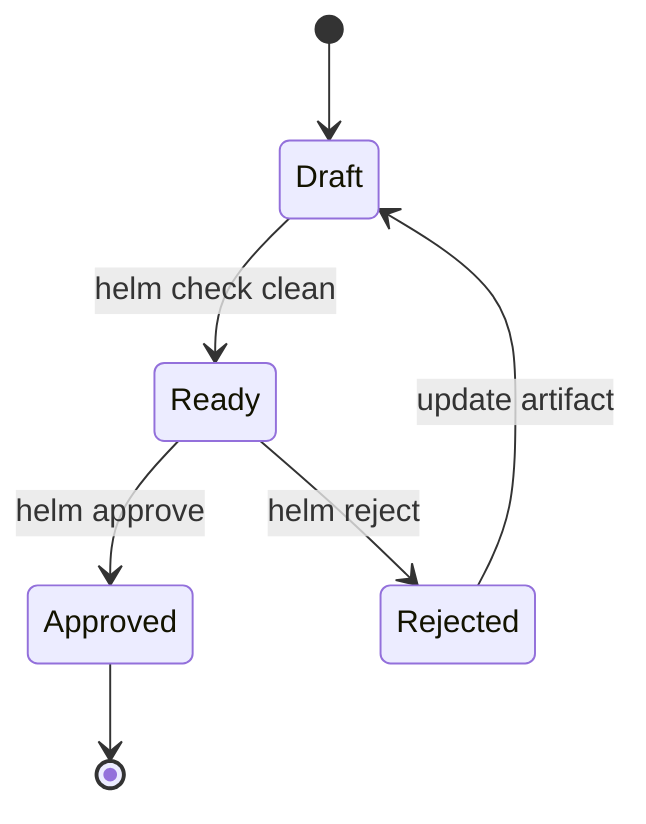
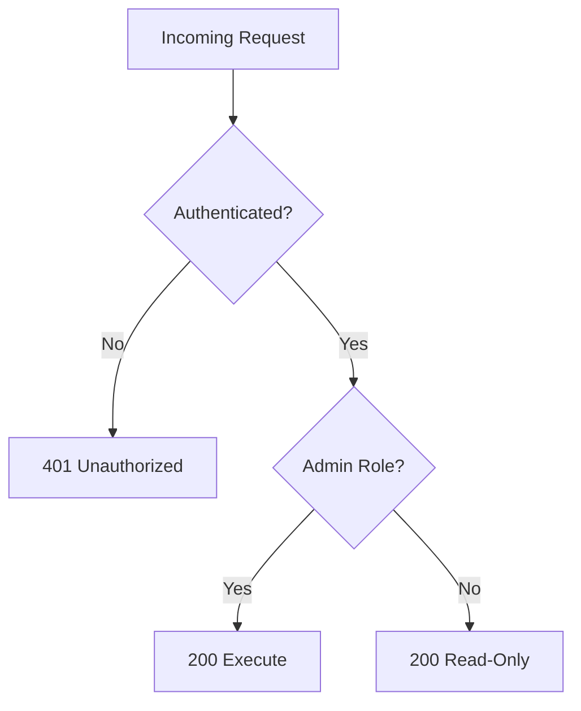

# HELM Mermaid Micro-Diagram Standards

This document establishes the architectural diagramming standard across the HELM framework.

---

## 1. Core Rationale & Philosophy

Software architecture and control flow are multi-dimensional; prose is linear.
Describing sequence flows, asynchronous boundaries, and state machines purely in natural language creates ambiguity, risks hallucinated transitions during agent handoffs, and triggers expensive plan-rejection loops (~10,000–20,000 token churn).

HELM embeds pure **Mermaid.js micro-diagrams** into planning and decision gates to solve this:
- **Human Reviewers**: Verify call sequences and state machines in under 5 seconds.
- **AI Agents**: Receive and emit deterministic Abstract Syntax Trees (ASTs) that eliminate hallucinated state jumps.
- **Zero Dependencies**: Pure Mermaid renders natively across modern development environments (VS Code, Cursor, JetBrains WebStorm) and GitHub Markdown with zero external binaries, npm packages, or background services.

---

## 2. Format Policies

### Approved Format: Mermaid.js Exclusively
All architectural diagrams in HELM artifacts (`PLAN.md`, `BLOCKED.md`, `docs/`) must use standard Mermaid.js code blocks (` ```mermaid `).

### Explicitly Banned Formats

| Format | Why Banned | Failure Mode |
|---|---|---|
| **ASCII Art** | +300% token inflation | Character fragmentation (spaces, pipes, hyphens) consumes massive context budgets and is non-deterministic for LLM parsers. |
| **Visual Canvases** (Excalidraw, tldraw) | 3,000–6,000 token bloat | Unreadable raw coordinates in Markdown, no human-readable diffs, massive payload overhead. |
| **PlantUML / D2** | Heavy runtime dependencies | Requires Java, Graphviz, or custom Go binaries, violating HELM's zero-dependency standard. |

---

## 3. The Three Golden Types

To prevent visual noise and preserve brevity, only three Mermaid diagram types are permitted:

### 1. `sequenceDiagram` — Interaction & Flow
Used for UI-to-API calls, cross-module workflows, client-server sync, and multi-agent coordination.



### 2. `stateDiagram-v2` — Lifecycle & State Machines
Used for discrete entity lifecycles (order states, auth transitions, task stages).



### 3. `flowchart TD` — Branching & Conditional Logic
Used for complex decision trees, authorization rules, or algorithmic branching. **Strictly capped at $\le 8$ nodes.**



---

## 4. Anti-Bloat Rules

Every diagram must adhere to three mandatory constraints:

1. **Micro-Diagram Budget ($\le 12$ Lines)**:
   - In `PLAN.md`, any diagram under `## Approach` must not exceed 12 lines of Mermaid markup. This protects HELM's 120-line hard ceiling.
   - In `BLOCKED.md`, twin comparative diagrams must not exceed 6 lines each.

2. **Single Source of Truth Rule**:
   - The diagram owns sequence, state transitions, and actor boundaries.
   - Prose owns data types, schemas, and business rationale.
   - **Never duplicate diagram steps in accompanying prose.**

3. **Label Syntax Safety**:
   - Always enclose labels in double quotes (e.g., `Node["Label (Info)"]` or `A->>B: "Execute(id)"`) to avoid Mermaid syntax parse errors caused by parentheses, colons, or reserved characters.
